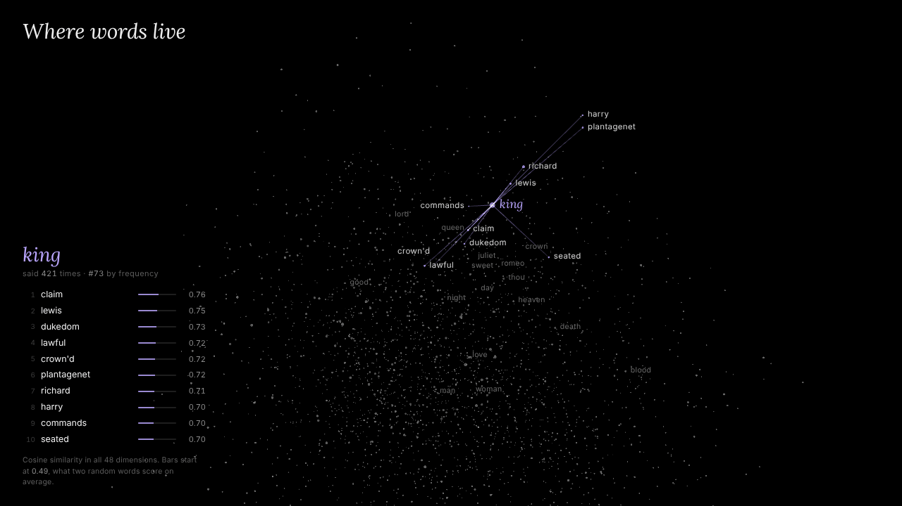

# Where words live

[](loop/embed-loop.mp4)

<sub>11-second loop. Click for the MP4 (1280×720, 2.9 MB); the GIF above is 1280×720, 5.7 MB.</sub>

Skip-gram word2vec with negative sampling, trained from scratch in NumPy on tiny-shakespeare. The 3,000 most common words are shown as points in 3D. Pick a word, by clicking, searching or tapping a chip, to see its ten nearest neighbours with their cosine values. Lines join the word to those neighbours.

Open `index.html` in a recent browser. Keep `words-data.js` next to it: the page is 45 kB and the vectors and vocabulary (447 kB) load from `words-data.js` after the words have painted (split on 2026-11-09; mobile Lighthouse, localhost, uncompressed: performance 89 → 100, first paint 3.0 s → 0.9 s). It is not self-contained: three.js 0.147.0 loads from cdn.jsdelivr.net (and the Lora/Inter fonts from Google Fonts, with system fallbacks). If three.js does not arrive, the page keeps its header and How it works panel and shows a quiet grey line saying the 3D view could not load.

## What it shows, and what it does not

- **The points.** Each point is one word's input vector, unit-normalised and projected to 3D with **PCA**, which is linear. The three axes keep only **26.2%** of the variance (11.0%, 7.8%, 7.4%), so distances in the 3D view are heavily distorted. PCA axis signs are arbitrary; `export.py` fixes them by rule (each axis's long tail points the + way), which changes no distance or number.
- **The neighbours.** Neighbours are computed in the browser with **cosine similarity in the full 48 dimensions**, never from the 3D positions. This is why some neighbour lines run long: words that are close in 48-d can land far apart in the 3D view.
- **Point size** follows log frequency.
- **What the PCA axes separate.** Four of the six axis ends lean toward one play each (Shrew/Measure, Coriolanus, Henry VI, Romeo and Juliet); two are mixed. The word lists come from the export (`summary.json` → `pca.ends`, 8 words per end); the play each group leans toward is computed (`*_group.play`), and the descriptions in brackets are a reading of the lists.
  - axis 1, low end: fare, pompey, petruchio, hic, gremio, biondello, troth, advise (names from The Taming of the Shrew and Measure for Measure; as a group, busiest in the Shrew)
  - axis 3, high end: tribunes, patricians, volsces, honours, weapons, tongues, lartius, wives (the Rome of Coriolanus)
  - axis 2, high end: post, george, london, norfolk, amain, march, towards, lancaster (words of the English history plays, concentrated in 3 Henry VI)
  - axis 3, low end: kill'd, child, rosaline, cursed, husband, villain, kinsman, wast (Romeo and Juliet)
  - mixed: cheeks, flood, fiery, hollow, bright, fatal, sceptre, glory (axis 1, high) / in't, big, report, ignorant, accused, fancy, nose, thief (axis 2, low)

  How tied to a play (`pca.ends[*].*_group`, `pca.group`): the plays sit one after another in the file, so for each group of 8 words, find the single window of 10% of the token stream that holds the largest share of their uses. The share is averaged over the 8 words, so each word counts equally, and it is computed exactly at token level. Random groups of 8 vocabulary words (10,000, seed 0) average **21%**, with 95th and 99th percentiles of **28%** and **33%**.

  | end | share in its busiest tenth | where | percentile vs random groups (5% / 10% / 15% windows) |
  |---|---|---|---|
  | axis 1 low (fare, pompey, petruchio…) | **55%** | 0.875–0.975 of the text, The Taming of the Shrew | 100 / 100 / 100 |
  | axis 3 high (tribunes, patricians…) | **61%** | 0.009–0.109, Coriolanus | 100 / 100 / 100 |
  | axis 2 high (post, george, london…) | **41%** | 0.527–0.627, 3 Henry VI | 99.4 / 100 / 100 |
  | axis 3 low (kill'd, child, rosaline…) | **34%** | 0.404–0.504, Romeo and Juliet | 99.5 / 99.5 / 98.9 |
  | axis 1 high (cheeks, flood, fiery…) | 25% | 0.532–0.632 | 91.0 / 84.5 / 90.9 |
  | axis 2 low (in't, big, report…) | 27% | 0.654–0.754 | 88.9 / 92.5 / 96.6 |

  The four tied ends stay at or above the 99th percentile with 5%, 10% and 15% windows, apart from Romeo and Juliet at 15% (98.9th). The two mixed ends stay below the 95th percentile at 5% and 10%, but the in't/big/report end reaches the 96.6th at 15%, leaning toward The Winter's Tale. The page uses the 10% window. An independent re-audit found the same figures within about a point, using 0.1%-binned positions and its own random groups.

  **This measure replaced an earlier one, after the results had been seen.** The earlier, per-word measure let each word pick its own densest 10% window and averaged those 8 maxima (still in `summary.json` as `*_loc` and `pca.loc`). On it, the average word scores 0.41 and random 8-word groups have 95th and 99th percentiles of 0.53 and 0.59. The ends score 0.79 (Shrew), 0.65 (Coriolanus), 0.51 (history), 0.45 (Romeo and Juliet) and 0.41 / 0.41 (mixed). That measure cannot see a group whose words share one play but are also common in others (*child*, *march*, *husband*), so it understated the history and Romeo and Juliet ends. In run 2 its verdict on the history end also flipped across the 95th percentile. A re-audit pointed this out, and the page now reports the group measure. `build.py` asserts what the page says (the four tied ends above the random 99th percentile, each in the named play; the two mixed ends below the 95th) before writing the page.

## Method

| step | what was done |
|---|---|
| text | tiny-shakespeare (`input.txt`, from char-rnn). Speaker labels such as `ROMEO:` are removed, so a name counts only when a character says it. A label is a line that follows a blank line (or starts the file) and ends with `:`; in this file that is the first line of every block, 7,222 lines, including two `Senators, &C:`. Dialogue lines that end with a colon ("March on, my fellows:") are kept. The page header `3 KING HENRY VI`, which occurs 27 times, is also removed (rule: a line of capitals, digits and spaces only, with at least two letters; in this file it matches only that header). The file has no act or scene markers and no stage directions. Lower-cased, tokens `[a-z']+` with outer apostrophes stripped. This gives 193,931 tokens and 12,348 types. |
| vocab | Top 3,000 by count, ties broken alphabetically. Covers 91.6% of tokens; the rarest kept word appears 5 times. Other words are dropped from the stream before windowing. |
| split | The last 5% of the in-vocab stream (8,884 tokens) is held out. Its counts are not used for sub-sampling or the negative table. The vocabulary itself was chosen from whole-corpus counts, held-out part included. |
| model | Two 3000×48 matrices, W_in (centre) and W_out (context). Loss per pair: `−log σ(u_o·v_c) − Σ_k log σ(−u_k·v_c)`. |
| gradients | Derived by hand (`train/w2v.py` docstring) and checked against central finite differences on V=7, D=4, batch 3, k=2, with repeated indices: max relative error **1.2e-9** (W_in) and **5.6e-10** (W_out). See `train/gradcheck.json`. |
| training | 15 epochs; dynamic window up to 5; 5 negatives from unigram^0.75; sub-sampling t=1e-3; lr 0.025 decaying linearly to 0; batches of 256 pairs; seed 20261106. About 120,706 tokens kept per epoch, 10,865,294 pairs in total. **136 s** on 2 shared CPU cores (the first run took 72 s when the machine was less busy). |
| export | Vectors unit-normalised, then stored as **float16** (base64), together with the vocab, counts and float16 PCA coordinates. The page decodes the halves to float64, normalises again, and ranks by dot product with ties broken by index. `export.py` computes the reference neighbours in exactly the same way. |

### What is standard, and what is not

Standard, as in Mikolov et al. and the original C tool:
- skip-gram with negative sampling
- k=5 negatives drawn from unigram^0.75
- the C tool's sub-sampling keep probability `(√(f/t)+1)·t/f`
- a dynamic window up to 5
- lr 0.025 with linear decay
- W_in initialised uniform in ±0.5/D and W_out at zero
- the input vectors used as the embeddings

Not standard:
- **Mini-batches of 256 pairs** with summed `np.add.at` updates, where the C tool does per-pair Hogwild SGD.
- **Negatives are not filtered.** A negative can equal the true context word; the C tool skips that case.
- **48 dimensions** and a **194k-word corpus**, against 100–300 dimensions and billions of words in the papers.
- The vocabulary is capped by rank rather than by min_count.
- Speaker labels and a repeated page header are removed.
- A held-out split is used, only to report a loss.
- Vectors are stored as float16 for the page.
- The 3D view is PCA, for display only.

## Numbers (all from `train/log.json` and `train/summary.json`)

- **Held-out loss.** Negative-sampling loss per pair on the held-out 5%, with fixed negatives and no sub-sampling: **4.159** at init (exactly 6·ln 2, knowing nothing), **2.748** after epoch 1, **2.669** at the end (best 2.667, epoch 14). Nearly all of the gain (95%) came in the first epoch.
- **Training loss.** 2.939 in epoch 1, 2.500 in epoch 15. Training pairs are sub-sampled and held-out pairs are not, so the two numbers are not directly comparable.
- **Cosine inflation.** Two random words score **0.49** cosine on average (99th percentile 0.797), and a word's 10th neighbour scores 0.80 at the median. All the vectors share a common direction, so the absolute cosine values look high. Read them as ranks. The page's bars start at 0.49 for this reason.
- **float16.** Against float64, **2,984 of 3,000** top-10 lists are identical and 16 swap exactly one word.

### Pre-registered probes

The 20 probe words and 8 analogies in `train/probes.json` were written before the first training run and were not changed afterwards. No hyperparameters were tuned. The model was trained three times, with the same settings and seed. The first run's text cleaning also deleted 1,315 lines of dialogue that end in a colon (about 10,000 words). An independent audit caught it, and the second run fixed only that. The third run also removed 27 copies of a page header (`3 KING HENRY VI`) that the second run had left in the text. Every number here is from the third run.

Neighbours (top 10, cosine; full list in `train/summary.json`):

| word | neighbours |
|---|---|
| king | claim .76, lewis .75, dukedom .73, lawful .72, crown'd .72, plantagenet .72, richard .71, harry .70, commands .70, seated .70 |
| love | protest .70, forgive .70, hate .69, cherish .66, recompense .65, devotion .64, heart's .64, modesty .64, burden .63, pure .63 |
| night | morning .72, morrow .69, wedding .67, light .67, blunt .66, neighbour .65, waking .65, captain .65, church .65, repose .65 |
| romeo | tybalt .79, juliet .74, banished .72, alive .70, conjure .70, romeo's .69, dog .68, mercutio .68, murderer .67, arise .67 |
| thou | thyself .74, dost .74, art .73, wilt .73, liest .71, hast .71, varlet .70, wouldst .69, wert .68, comest .67 |
| sword | seize .73, bending .71, gage .71, hands .70, executioner .68, pack .67, hereford's .67, weight .67, resolution .66, wrath .66 |
| man | example .71, sooner .70, cat .67, beard .67, frantic .67, month .66, rascal .66, soldier .66, damnable .66, question .65 |
| woman | respected .79, humour .76, frantic .75, peevish .74, wrong'd .73, elder .72, flower .71, wench .71, mad .71, damnable .70 |

Some lists are good (romeo, thou, lord, king), and some are mostly noise (man, woman, good, sweet). That mix is honest for a corpus this size.

Analogies, using 3CosAdd on unit vectors and excluding the three query words: **2 of 8** hit.

| b − a + c → target | top answer | rank of target |
|---|---|---|
| king − man + woman → queen | supposed | 28 |
| father − man + woman → mother | elder | 291 |
| his − he + she → her | her | **1** |
| father − son + daughter → mother | katharina | 85 |
| sister − brother + son → daughter | wife | 19 |
| lady − lord + king → queen | virtuous | 15 |
| night − day + sun → moon | breaks | 6 |
| thy − thou + you → your | your | **1** |

The two hits are function-word analogies (his/her, thy/your). These are learnable from a small amount of text because the words are frequent and fill rigid syntactic slots. The famous king − man + woman fails: *queen* comes 28th. Across the three runs the score went 2, 1, 2 of 8 and *queen* came 49th, 6th, 28th: with this few hits, and ranks this unstable, the analogy numbers mean little beyond "mostly fails".

## Verification

Checked in headless Chromium with software WebGL (the Playwright check is not in this repository yet):
- **0 page errors** at 1440×900, at 375×812 (touch) and with reduced motion, and with three.js blocked, where the fallback line shows and How it works still opens and closes.
- **Phones** (iPhone 13, iPhone SE and 844×390 landscape sizes): no horizontal scroll, the panel touch-scrolls to the credit and closes with ×, and 3D labels never print over the title, caption, list or dock.
- **The page's neighbours equal NumPy's on all 20 probes**: the same 10 words in the same order (max |Δcos| 5e-5, the rounding of the stored reference).
- **Interaction:** search with prefix suggestions, an out-of-vocabulary message, clicking a point or a list row to hop to that word, dragging to orbit, and How it works closing on Esc.
- **Reduced motion:** no redraws while idle (no auto-spin), and selection jumps instead of flying.

## Limits

- **Tiny corpus.** 194k words from a handful of plays. The geometry reflects *which play a word comes from* about as much as what it means, and four of the six PCA axis ends show this.
- **One seed, and unstable lists.** The three runs used the same seed, but the text changed slightly between them, so the random draws differed. Removing just 81 header tokens (0.04% of the text) between the second and third runs changed most mid-frequency neighbour lists noticeably. Read any single list as one sample, not as a fixed property of the words. Seed-to-seed variation was not measured systematically.
- **Unreliable rare words.** A word seen 5 times gets a vector from a few dozen context pairs per epoch, so neighbour lists for rare words are unreliable.
- **Cosine values are inflated** by a shared direction (random pairs average 0.49). No post-processing, such as mean removal, was applied, so the numbers stay those of plain word2vec.
- **The 3D view distorts distance.** PCA keeps 26.2% of the variance. Use the list, not the picture, to judge closeness.
- **The held-out loss** only shows that the model predicts real context pairs better than chance. It does not measure semantic quality.

## In this repository

- `index.html`: the piece, built from `index.src.html` by `build.py`.
- `words-data.js`: the page data (`window.WWL_DATA`), also written by `build.py`.
- `train/w2v.py`: tokeniser, vocab, loss, hand-written gradients and neighbours.
- `train/gradcheck.py` → `train/gradcheck.json`
- `train/probes.json`: the pre-registered probes and analogies.
- `train/train.py` → `train/ckpt.npz`, `train/log.json`
- `train/export.py` → `train/data.json` (page data), `train/summary.json` (every reported number), `test/expected.json` (reference neighbours)
- `train/log.json`, `train/summary.json`, `train/gradcheck.json`: the shipped run's outputs, so every number above can be checked without retraining.
- `screenshots/`: *romeo* selected, and the phone layout
- `loop/`: the loop video, its GIF and a poster

## Rebuild

Needs Python 3 and NumPy. Put tiny-shakespeare next to this README as `input.txt`, then train, export and build:

```bash
curl -o input.txt https://raw.githubusercontent.com/karpathy/char-rnn/master/data/tinyshakespeare/input.txt
cd train && python3 gradcheck.py && python3 train.py && python3 export.py && cd .. && python3 build.py
```

Training is deterministic with the fixed seed and took 136 s on 2 shared CPU cores. `build.py` fills the page's numbers from `train/summary.json` and stops the build if a hand-written sentence about the results no longer matches the data. The text used here has md5 `6fb458f1232090904fb40fe944165e91`.

## Credits

- Tomas Mikolov, Kai Chen, Greg Corrado, Jeffrey Dean. *Efficient Estimation of Word Representations in Vector Space.* 2013. arXiv:1301.3781.
- Tomas Mikolov, Ilya Sutskever, Kai Chen, Greg Corrado, Jeffrey Dean. *Distributed Representations of Words and Phrases and their Compositionality.* 2013. arXiv:1310.4546. This is the source of negative sampling and sub-sampling.
- tiny-shakespeare, from Andrej Karpathy's [char-rnn](https://github.com/karpathy/char-rnn).
- three.js 0.147.0 (MIT); the fonts are under the SIL Open Font License.

Code: MIT. See [LICENSE](LICENSE).

Built with Claude for Joe Gao.
